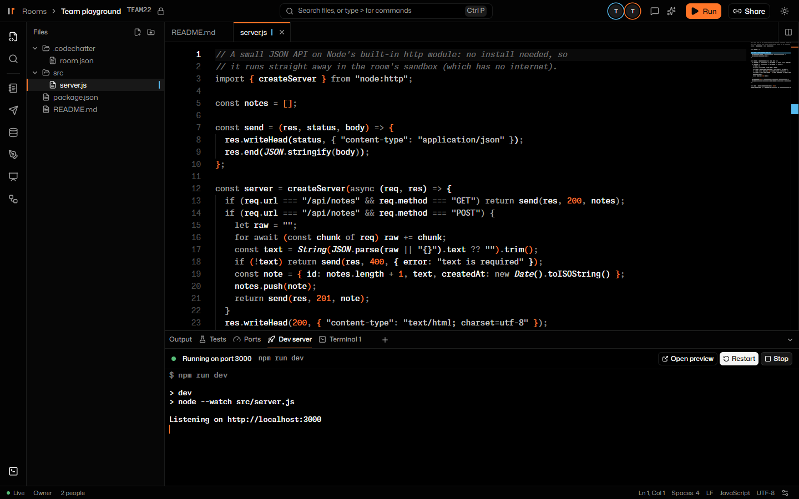
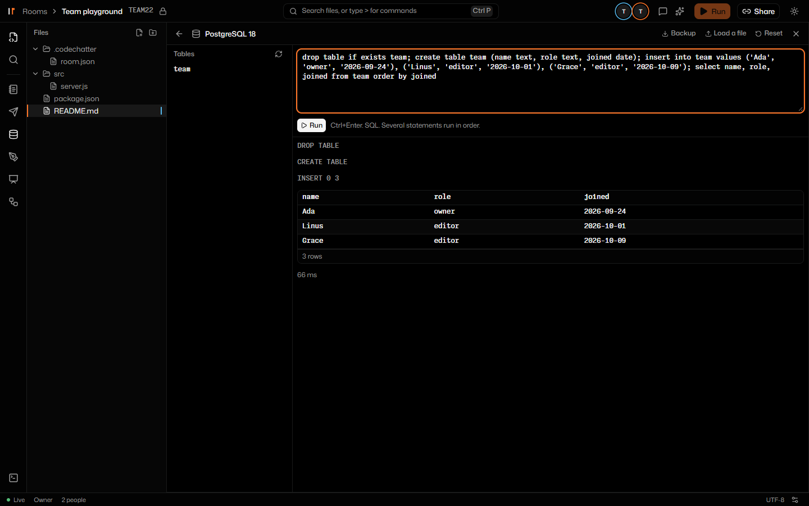
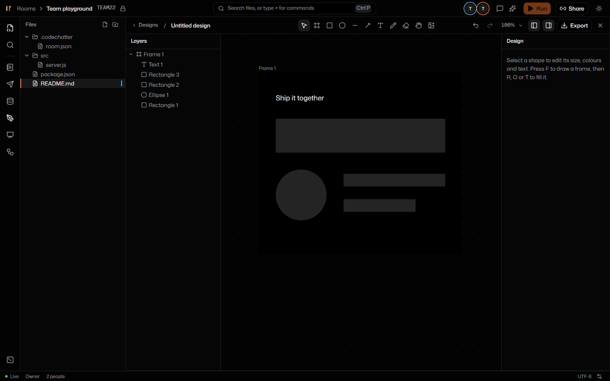
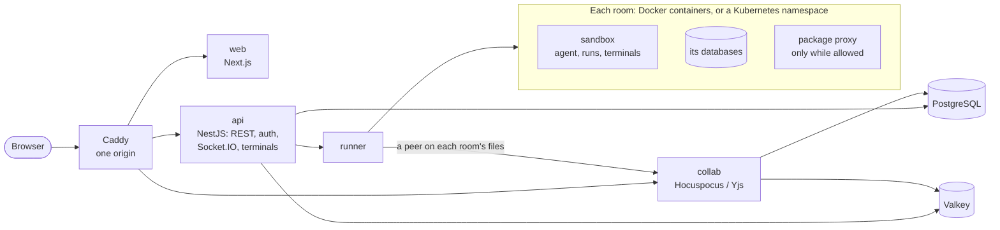

# CodeChatter

A collaborative IDE in the browser. People in a room edit the same files live, and run them in the room's own isolated sandbox. The room also brings databases, a live preview of its dev server, AI help and design tools into the same place.



## What it does

- **Edit together.**
  - One shared editor (Monaco on a Yjs CRDT): live cursors and presence, and follow mode.
  - Search and replace across files, split and diff editors, and a command palette.
  - Ghost-text AI completions as you type.
- **Run anything.** Every room has its own sandbox: a container on Docker, or a pod on Kubernetes.
  - Run for 31 languages, and shared terminals.
  - A judge that checks code against test cases.
  - A preview of the room's dev server, on an origin of its own.
- **Start from a template.** React, Vue, Svelte, Express with Postgres, FastAPI, Flask or Django. The room's dev server installs what it needs and starts, as `.codechatter/room.json` says.
- **One-click databases.** PostgreSQL, MySQL, MariaDB, MongoDB and Redis per room. Each comes with a query console, a table browser, backups, seeds and a reset.
- **AI in the room.**
  - Chat about the code, and edits you review as diffs.
  - An agent that runs commands in the sandbox, and completions as you type.
  - Runs on Ollama, Claude, Gemini or any OpenAI-compatible API.
- **Tools beside the code.**
  - Shared docs and a whiteboard.
  - A design canvas with frames, layers, exports, and CSS or HTML handoff.
  - Diagrams, and an HTTP client for the room's own server.

| One-click databases | The design canvas |
|---|---|
|  |  |

## Safe to share a room

- **Locked-down sandboxes.**
  - Each room's sandbox runs as a non-root user, with a read-only root, no capabilities, seccomp, and memory and process limits.
  - None of the server's secrets are in it. A fork bomb or a program that runs out of memory resets the sandbox, not the server.
- **Private networks.**
  - A room's network reaches only the room's own services: not the internet, not the host, not other rooms.
  - Package installs open only when the room's owner allows them, through a proxy that lets HTTPS reach package registries and nothing else.
- **On Kubernetes, the same rules.**
  - A NetworkPolicy per room, and a Secret per room for its database password.
  - The runner has only the access it needs, and an admission policy keeps it to its rooms' namespaces.

## How it fits together



The runner is the only part that can reach Docker or the cluster, and only the API can reach the runner. The runner keeps each room's files in sync between the shared document and the sandbox, through a small agent inside the sandbox.

## Built with

| | |
|---|---|
| Web | Next.js 16, React 19, Tailwind CSS 4, shadcn/ui, Monaco, xterm.js |
| Real time | Yjs with Hocuspocus, Socket.IO |
| API | NestJS, Better Auth (sessions, email verification, Google and GitHub sign-in), zod contracts shared across the monorepo |
| Data | PostgreSQL 18 with Drizzle, Valkey 9 |
| Sandboxes | Docker, or Kubernetes through `@kubernetes/client-node`; a Helm chart for the whole app |
| Quality | TypeScript end to end, Vitest, Playwright, pnpm and Turborepo |

## Run it locally

With Node 24, pnpm and Docker Desktop:

```sh
pnpm install
cp .env.example .env    # then set BETTER_AUTH_SECRET and SERVICE_SECRET, as the file shows
pnpm setup              # databases, migrations, test data, the sandbox image
pnpm dev                # http://localhost:8080
```

Sign in as `test1@codechatter.local` with the password `codechatter123`, and open the room "Team playground".

## Run it on Kubernetes

The Helm chart in [`infra/helm/codechatter`](infra/helm/codechatter/README.md) runs the whole app on a cluster. Each room gets a namespace of its own on the same cluster. Its defaults are a demo on Docker Desktop's built-in Kubernetes:

```sh
pnpm k8s:images && pnpm sandbox:build
helm install codechatter infra/helm/codechatter --namespace codechatter --create-namespace
# then open http://localhost:8090
```

## Tested end to end

Every feature has a test against the running app: real sandboxes, real databases and a real browser.

- **Runner suites** (runs, terminals, isolation, installs, databases, every language), on both Docker and Kubernetes:

  | Suite | Checks |
  |---|---|
  | runner | 23 |
  | network isolation | 11 |
  | package installs | 24 |
  | databases | 33 |
  | dev server | 8 |
  | every language | 26 |
  | judge | all pass |

- **Browser suites** (Playwright and Edge), against the dev stack and the Kubernetes demo:

  | Suite | Checks |
  |---|---|
  | templates | 8 |
  | editor | 16 |
  | search | 23 |
  | databases | 15 |
  | canvas | 12 |
  | docs | 8 |
  | installs | 7 |
  | inline completions | 14 |
  | and more | |

- **Unit tests:** hundreds of them across the API, the runner, the contracts and the sandbox agent.

## Read more

- [Roadmap](docs/roadmap.md): what's built, and what's next
- [Decisions](docs/adr): why it's built this way, one decision per record
- [Code map](docs/code-map/README.md): every file, what it does, and how the parts connect
- [Deploying](docs/deploy.md): one server with Docker, or Kubernetes

`client/` and `server/` hold the first version (React and FastAPI). It is being retired.
