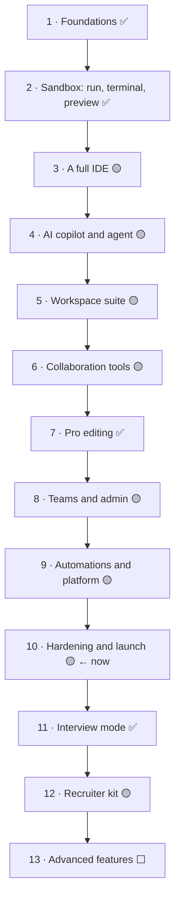

# CodeChatter v2: the pathway

A real-time collaborative IDE. People code together in the same files, run code in a private sandbox, talk, draw, and get help from AI.

This page is the path from start to launch: the stages in the order they're built, each with its goal and one line per piece.
- **What's left**, in the order it'll be done, and who's doing it: [pending.md](pending.md)
- **How each piece was built and tested:** [roadmap-details.md](roadmap-details.md), by the § numbers given here

**Legend:** ✅ done and tested · 🟡 partly done or in progress · ⬜ not started

Both this page and pending.md are updated after every finished piece.

## Where we are (2026-11-06)

- **Done:**
  - the foundations, the sandbox and most of a full IDE (steps 1–3);
  - pro editing, including real git in the sandbox (step 7);
  - collaboration, apart from TURN over TLS (step 6).
- **In progress:**
  - **hardening for launch** (step 10): backups, security, accessibility;
  - **teams** (step 8): members, invitations, account security;
  - **platform** (step 9): follow-ups.

  These are mostly with ChatGPT, through the prompts in `docs/handoff/`.
- **Just done:** interview mode (step 11).
- **Next:**
  - security, accessibility and the cutover from v1 (step 10);
  - the recruiter kit's video (step 12).

---

## Step 1 · Foundations and live editor ✅

*Goal: one shared editor that several people type in at once, with accounts and rooms.* Details: §1.

- ✅ Monorepo (pnpm, Turborepo), TypeScript throughout; local infrastructure with one command (Postgres, Valkey, Mailpit, S3, Caddy)
- ✅ Database schema and migrations (Drizzle)
- ✅ Better Auth: email and password with verification, password reset, two-factor sign-in step; Google and GitHub sign-in; real email
- ✅ NestJS API: rooms, members, invite links, audit events, Problem+JSON errors, health checks
- ✅ Hocuspocus (Yjs) with Postgres persistence and Valkey scale-out; the room's file tree in Yjs
- ✅ Next.js app: black, white and orange design, light and dark; landing page with a live typing demo
- ✅ Dashboard, rooms from templates, join by code or link; the room IDE; room chat
- ✅ Works from a phone on the same Wi-Fi; production Docker images and compose with HTTPS

## Step 2 · Sandbox: run, terminal, preview ✅

*Goal: run real code safely, together.* Details: §2.

- ✅ A sandbox container per room, with a file-sync agent inside, and a runner service
- ✅ Run button with shared output and input, limits, and the latest edits always used
- ✅ Shared terminals; static and dev-server previews; ports and resources panel
- ✅ Competitive-programming helper (samples, ✓/✗ diffs); Python notebooks
- ✅ Network switch for package installs (owner only, audited, times out)
- ✅ Tools plug-in point; room documents; rooms can't read each other's files
- ✅ Runner and browser end-to-end tests in their own room (E2ETST)

## Step 3 · A full IDE 🟡

*Goal: what VS Code users expect, in the browser.* Details: §14.

- 🟡 **Editor at VS Code level** (§14 A):
  - ✅ command palette, command centre, Quick Open, breadcrumbs, Outline
  - ✅ multi-cursor, folding, sticky scroll, format on save, snippets, Emmet
  - ✅ split and grid editors, compare files, Markdown preview, Zen mode
  - ✅ file previews, including images, PDFs, fonts, audio and video
  - ✅ IntelliSense for Python, C/C++, Go, Java (TypeScript in the browser); Problems and Check all files
  - ✅ formatters; a shared debugger for Python, C/C++, Go, JavaScript/TypeScript and Java
  - ✅ personal settings synced to your account, Vim keys, themes, tasks and `launch.json`
  - ⬜ Emacs keys, one shared Java language server, Node debug extras, extensions from Open VSX
- ✅ **Every language** (§14 B): 26 languages; base or full image per room
- ✅ **Room network** and **Docker housekeeping**: isolation, package installs, cleanup
- ✅ **One-click databases** (§14 D): Postgres, MySQL, MariaDB, MongoDB, Redis; SQLite and DuckDB files
- 🟡 **Frameworks** (§14 C): `room.json`, the Dev server tab, 20+ templates that start in one click, warmed caches
- 🟡 **Kubernetes** (§14 F): the playground, the panel, a Kubernetes-aware editor, the Helm chart, a Kubernetes runner driver and a free demo
- ✅ **GitHub** (§14 E): sign in, import, source control, pull requests, webhooks, export

## Step 4 · AI copilot and agent 🟡

*Goal: help that understands the room.* Details: §4.

- 🟡 Provider router: Ollama (local, free), Claude, any OpenAI-compatible server; per-organisation keys ⬜
- ✅ AI panel: streamed answers with context chips and images. Modes: assistant, explain error, tutor, mock interviewer, complexity, screenshot to code, edit, agent, room summary
- ✅ Inline completions; AI edit with review; Explain this error and Fix
- ✅ The agent plans and proposes steps that wait for approve or skip
- ⬜ AI diagram; agent auto-approve and retry loop; the agent's own typeface
- 🟡 Usage: token counts and per-person limits ✅; organisation quotas ⬜

## Step 5 · Workspace suite 🟡

*Goal: Notion, Obsidian, Postman, Figma and Slack features inside the room.* Details: §13.

- 🟡 **Docs** (like Notion): block editor, page tree, templates, comments, history, publish
- 🟡 **Knowledge base** (like Obsidian): links, graph view, organising, code links
- 🟡 **API studio** (like Postman): collections, request builder, environments, tests, cURL import, snippets
- 🟡 **Design canvas** (like Figma): multiplayer vectors, layers, components, auto layout, export, CSS handoff
- 🟡 **Diagrams** (draw.io): edited together live, in the app's look, with export. Production hosting ⬜
- ⬜ **Messaging** (like Slack): channels, threads, huddles, bots, search
- ⬜ **Across the suite:** one command bar, one permissions model, AI everywhere

## Step 6 · Collaboration tools 🟡

*Goal: what makes it a room, not just an editor.* Details: §5.

- ✅ Whiteboard; Mermaid flowcharts with a live preview; shared and private notes with a focus timer
- 🟡 Video and voice (LiveKit): development and production ✅; TURN over TLS and a screen-share test ⬜
- ✅ GitHub import, commit, push and pull requests
- ✅ Files: upload, folder upload, zip import and export, and **binary files** in S3 (images, PDFs, fonts, data)
- ✅ Notifications: inbox, email digest, room activity
- ✅ Public rooms: explore, read-only visits, fork

## Step 7 · Pro editing ✅

*Goal: the tools professionals rely on.* Details: §6.

- ✅ Language servers in the sandbox; time travel (checkpoints and restore); inline comment threads
- ✅ Search and replace; split and diff editors; follow and present mode; palette and shortcuts
- ✅ Secret scanning before a push
- ✅ Source control: the GitHub API way, and **real git in the sandbox** (stage, commit, branches, history; push to a remote ⬜)

## Step 8 · Teams and admin 🟡

*Goal: what an organisation needs.* Details: §8.

- 🟡 Organisations: teams, members, invitations (ChatGPT, prompt 9)
- ✅ Managing a room's people: approve, decline, remove, change roles, leave, and an invite link from Share. Rights changing closes what the person has open
- 🟡 Settings: profile, password, two-factor, active sessions (ChatGPT, prompt 10)
- ✅ Audit log with filters and CSV export
- ✅ Room roles for interviews (interviewer, candidate)
- ⬜ Usage dashboard with quotas; instance admin

## Step 9 · Automations and platform 🟡

*Goal: CodeChatter as a platform others build on.* Details: §9.

- ✅ Outgoing webhooks: signed, retried, with a delivery log, leases and retention
- ✅ Dependency alerts from OSV, in a side tool
- ⬜ Pipelines, Jenkins-style; workflow builder; public API and `cc` CLI; MCP server; `devcontainer.json`

## Step 10 · Hardening and launch 🟡 ← now

*Goal: safe, observable and tested enough to run for real.* Details: §10.

- ✅ Load test: 500 live connections, p95 under 150 ms, across several processes
- 🟡 Operations: Prometheus metrics and Grafana ✅; nightly backups (ChatGPT, prompt 11); traces ⬜
- 🟡 GitHub Actions CI: lint, types, tests, image builds, vulnerability scan. Failing on a test interview mode broke; fixed, and waiting for the next push
- 🟡 End-to-end tests in CI: 37 suites. The first run on GitHub found three real problems, fixed; waiting for a green run
- ✅ Browser security: a nonce-based security policy, previews in a sandboxed frame, access that really ends when a room goes private or is deleted
- ⬜ Sandbox security (gVisor); accessibility (axe, Lighthouse)
- ⬜ Cutover from v1; a final security review

## Step 11 · Interview mode 🟡

*Goal: a complete hiring flow.* Details: §7 and `docs/interviews.md`.

- ✅ Question bank with visible and hidden tests
- ✅ Scheduling, interviewer and candidate roles, a single-use candidate link
- ✅ Server-side timer that really takes the candidate's rights away
- ✅ Hidden tests in a throwaway container; private rubric and scorecards
- ✅ Replay, and a report
- 🟡 Next version: many candidates at once, random questions from the bank, multiple choice, a record of suspicious behaviour, a results table

## Step 12 · Recruiter kit 🟡

*Goal: easy to show off.* Details: §3.

- ✅ "Try the demo" (one-click guest rooms); showcase mode for free hosting; the demo video script
- 🟡 README: written for v2 ✅; a GIF and a 2-minute video ⬜ (the owner records them)

## Step 13 · Advanced features ⬜

*Goal: what most IDEs don't have.* Details: §11.

- ✅ Multiplayer debugger; Problems panel, database playground and HTTP client (done in steps 3 and 5)
- ⬜ Suggestion mode, room branches, live authorship, session replay, smarter calls
- ⬜ Test explorer, profiler, package search, room secrets, deploy previews
- ⬜ Ask the codebase, AI team, natural-language terminal, generated tests and docs, AI code review
- ⬜ Classroom and contest modes
- ⬜ SSO and SCIM, billing, data controls, a plugin SDK
- ⬜ Hindi interface, installable app, mobile layout, embeddable rooms

## Ideas you picked (§12)

They're scheduled beside the step they need.
- **Built:**
  - resource monitor, ports panel, competitive-programming helper, every language, service add-ons;
  - tutor, mock interviewer, complexity and screenshot-to-code AI modes;
  - Markdown preview, Vim keys and Zen mode.
- **Still open** (in pending.md): in-browser runner, public profile, visualizer, code tours, a task board from TODOs, math in Markdown, a VS Code extension, interface languages.
